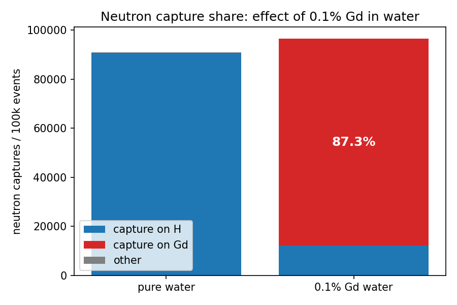
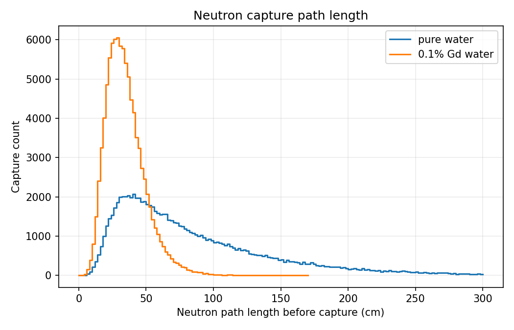
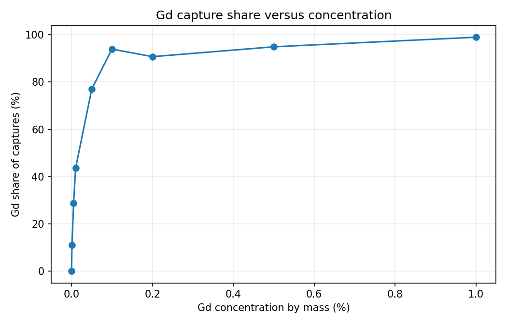
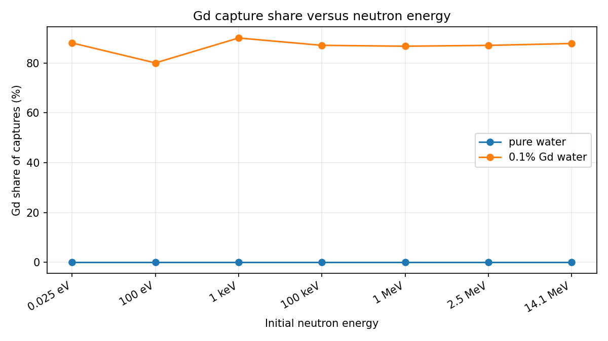
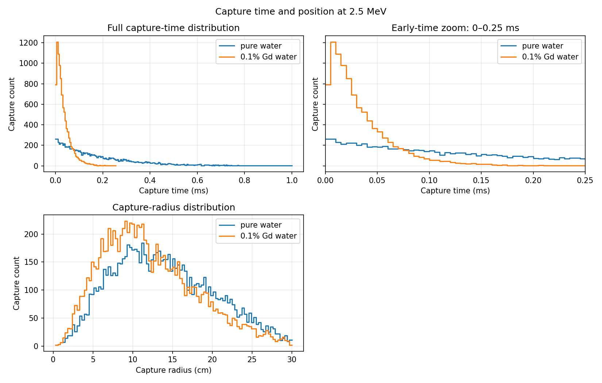

# Geant4 Neutron Capture in Gd-Doped Water — LEGEND-1000

Monte Carlo simulation of neutron thermalization and capture in water, built to
demonstrate that doping water with **0.1% gadolinium by mass raises the fraction
of neutron captures occurring on Gd to ~90%** — the basis of neutron tagging in
large water Cherenkov neutron vetoes.

The geometry is a simplified GERDA-like setup: a 10 m diameter x 9 m high
cylindrical water tank containing a central stainless-steel cryostat and liquid
argon inner volume. The water uses pressurized water (593 K, 150 bar) with
thermal-scattering hydrogen (`TS_H_of_Water`) and a modular HP physics list
(QGSP_BIC_HP + elastic HP).

## Physics claim

| | pure water | 0.1 wt% Gd in water |
|---|---|---|
| dominant capture | H-1 (2.2 MeV gamma) | Gd-155/157 (~8 MeV cascade) |
| thermal capture Σ | ≈ 0.022 cm⁻¹ (H) | ≈ 0.19 cm⁻¹ (Gd) + 0.022 cm⁻¹ (H) |
| Gd share of captures | ~0% | **~85–90%** |

The simulation reproduces the last row directly: the end-of-run report prints
the capture counts per element and the Gd capture share.

## Results at a glance

The figures below are selected presentation outputs from the simulation. They
are tracked separately in [`docs/figures/`](docs/figures/) so the README is
useful on GitHub without committing the full ROOT files, logs, or scan
datasets.

### Why gadolinium helps neutron tagging



This comparison shows the central physics result: in pure water, thermal
neutrons predominantly capture on hydrogen, while adding 0.1 wt% Gd shifts
most captures to gadolinium. Gd capture produces a higher-energy gamma cascade
than the 2.2 MeV hydrogen-capture gamma, making the neutron capture easier to
identify.

### Capture path length



The path length is the accumulated Geant4 neutron track length before the
`nCapture` step. It is not simply the straight-line distance to the capture
point: elastic scattering can make the path longer than the 30 cm sphere
radius. Gd reduces the typical path length because its larger thermal capture
cross section makes capture more probable after thermalization.

### Scan results



The concentration scan tests whether the Gd capture fraction increases
systematically as the Gd mass fraction increases. This is a more informative
check than a single 0.1 wt% comparison because it shows the trend and the
region of diminishing returns.



The energy scan compares pure water with 0.1 wt% Gd water over several initial
neutron energies. It shows how the initial fast-neutron energy changes the
thermalization and capture history before the neutron reaches the thermal
capture regime.



The capture-time panels show when captures occur after the neutron is created,
including an early-time zoom. The capture-radius panel shows where captures
occur inside the 30 cm absorber. Together, these distributions help check
whether Gd changes only the capture isotope or also the spatial and temporal
capture signatures.

The extended scan also produces:

- `escape_probability_vs_radius.png`: the fraction of primary neutrons that
  leave absorbers of different radii without being captured
- `capture_isotope_breakdown.png`: capture counts by residual nucleus
- `capture_length_by_isotope.png`: mean capture path length grouped by
  residual nucleus
- `detector_response.png`: deposited-energy threshold counts and capture-gamma
  response for the 2.5 MeV comparison
- `energy_containment.png`: event-level distribution of deposited energy
  divided by capture-gamma energy
- `energy_containment_vs_radius.png`: mean containment proxy versus absorber
  radius

These outputs distinguish the Gd share *among captures* from the probability
that an incident neutron is captured at all, identify the isotopes responsible
for the capture signal, compare path lengths by isotope, and connect the
nuclear capture process to a detector energy threshold.

### Energy containment

For each capture event, the scan records the total energy deposited in the
absorber and the capture-step gamma energy. It plots the containment proxy

```text
deposited energy / capture-gamma energy
```

A value near 1 means that the deposited energy is comparable to the energy
released in capture; lower values indicate more energy escaped the absorber.
The ratio can exceed 1 because the deposited energy also includes energy from
the incident neutron and other event products, so this is a capture-event
response proxy rather than a pure gamma-only containment fraction. The
radius-scan plot shows how this response changes as the detector becomes
larger.

## Requirements

- **Geant4** >= 10.7 (developed against 11.x), built with `ui_all vis_all`
- **CMake** >= 3.16
- **Python 3 + matplotlib** (only for the comparison plot)
- **ROOT** (only if you want to browse `neutron_capture*.root` interactively)

## Build

```bash
git clone <this-repo>
cd gd_water_repo
cmake -S . -B build
cmake --build build --parallel
```

The executable is `build/neu`. Macros and scripts are copied into
`build/macros` and `build/scripts` at configure time. The `build/` directory
is generated locally and is intentionally excluded from Git.

## Run

Batch mode (one macro file as argument):

```bash
./neu macros/run_gd.mac       # 0.1% Gd water, 2.5 MeV neutrons, 100k events
```

Interactive mode with OpenGL visualization:

```bash
./neu          # executes macros/vis.mac, then opens the Qt/SDL session
```

## Running in Docker

No local Geant4 installation needed. Two options:

**Option A — prebuilt image (fast).** Pull an existing Geant4 image, e.g.
Jefferson Lab's Ubuntu 24.04 build with Geant 4.11.3.2
(`docker pull ghcr.io/jeffersonlab/geant4-docker:11.3.2-ubuntu:24.04`)
or the official `geant4/geant4` image (full installation, data files
included, but several GB to download). Then mount the repo:

```bash
docker run --rm -it -v "$PWD:/workspace" -w /workspace \
  ghcr.io/jeffersonlab/geant4-docker:11.3.2-ubuntu:24.04 bash
cmake -S . -B build && cmake --build build --parallel $(nproc)
./build/neu build/macros/run_gd.mac
```

**Option B — project Dockerfile (fully reproducible, recommended).**
`Dockerfile` builds Geant 4.11.2.2 (Qt + GDML + all physics data
sets) on Ubuntu 24.04. Requires ~10 GB disk, internet during build, and
20–40 minutes:

```bash
./build.sh             # one-time: creates image g4gd:11.2.2
./run_docker.sh        # compiles the app in-container and runs the
                       # pure-water and 0.1%-Gd macros, then prints the
                       # capture summary
python3 scripts/plot_capture.py log_water.txt log_gd.txt
```

**Visualization from the container (Linux host, X11):**

```bash
xhost +SI:localuser:root
docker run --rm -it -e DISPLAY=$DISPLAY -v /tmp/.X11-unix:/tmp/.X11-unix \
  -v "$PWD:/workspace" -w /workspace/build g4gd:11.2.2 ./neu   # interactive + OGL
```

### Provided macros

| macro | configuration |
|---|---|
| `macros/run.mac` | original setup: 14.1 MeV neutrons on a Li-7 sphere |
| `macros/run1.mac` | original setup: 2.5 MeV neutrons on water |
| `macros/run_water.mac` | pure water reference (2.5 MeV, 100k events) |
| `macros/run_gd.mac` | 0.1% Gd-doped water (2.5 MeV, 100k events) |
| `macros/vis.mac` | interactive visualization |

Key macro commands:

```
/testhadr/det/setMat WaterGd_ts   # absorber material (Water_ts, HeavyWater,
                                  # graphite, NE213, or any NIST / isotope name)
/testhadr/det/setTankRadius 5 m   # cylindrical water-tank radius
/testhadr/det/setTankHeight 9 m   # cylindrical water-tank height
/testhadr/det/setCryostatRadius 1.5 m
/testhadr/det/setCryostatHeight 3 m
/testhadr/det/setIsotopeMat Li7 3 7 1.85 g/cm3   # build single-isotope material
/gun/particle neutron
/gun/energy 2.5 MeV
/analysis/setFileName <name>      # output base name for histograms
/analysis/h1/set <id> <nbins> <min> <max> <unit>  # (re)book + activate a histo
/run/beamOn 100000
```

## The 90% measurement

```bash
./neu macros/run_water.mac > log_water.txt 2>&1
./neu macros/run_gd.mac    > log_gd.txt    2>&1

grep -A2 "Neutron captures" log_water.txt log_gd.txt
# ->  Neutron captures : H = ...   Gd = ...   other = ...   (total ...)
#     Gd capture share = ... %

python3 scripts/plot_capture.py log_water.txt log_gd.txt
# -> prints the shares and saves gd_capture_share.png

python3 scripts/plot_capture_length.py log_water.txt log_gd.txt
# -> saves capture_length_comparison.png
```

The capture-length plot shows the neutron path length accumulated by Geant4
from primary neutron creation until the `nCapture` step. Capture lengths are
recorded in 2 cm bins from 0 to 300 cm in histogram 24 and summarized in each
simulation log. The 30 cm sphere limits the straight-line distance, but
scattering can make the accumulated path length longer than the sphere radius.

## Concentration, energy, time, and position scans

The scan harness runs a Gd-concentration scan at 2.5 MeV and an initial
neutron-energy scan for both pure water and 0.1% Gd water. It also records the
capture-time and capture-radius distributions for the 2.5 MeV comparison:

```bash
./run_scans_docker.sh 10000
python3 scripts/plot_scans.py scan_results
```

The argument is the number of events per case. Use a small pilot first, such
as `./run_scans_docker.sh 100`, before scaling to 10000 or more. Results are
written under `scan_results/`, which is intentionally excluded from Git:

- `gd_share_vs_concentration.png`
- `gd_share_vs_energy.png`
- `capture_time_position_comparison.png`
- `cases.csv` and one log per scan case

The concentration command `/testhadr/det/setGdFraction` accepts a mass
fraction from 0 to 1. The default scans use 0, 0.001%, 0.005%, 0.01%, 0.05%,
0.1%, 0.2%, 0.5%, and 1% Gd by mass. Capture time is the Geant4 global time
at the `nCapture` step; capture position is the radial distance from the
sphere center at that step.

Independent cross-checks in the ROOT output (`<file>.root`, histogram id 10,
"all other ions at creation"): excited **Gd-156/158 nuclei appear only in the
doped run; the "particles at creation" table in the log lists them by name.

## How it works

- **Geometry** (`src/NeuDetectorConstruction.cc`): a simplified GERDA-like
  cylindrical water tank (10 m diameter x 9 m high) contains a central
  stainless-steel cryostat with a liquid-argon inner volume. The water
  material can be swapped at run time via `/testhadr/det/setMat`; Gd doping
  applies to the water volume only.
- **Materials**: `Water_ts` (pressurized water, thermal-scattering hydrogen),
  `WaterGd_ts` (0.1 wt% natural Gd — natural Gd is 14.8% Gd-155 and 15.65%
  Gd-157, whose capture cross sections are ~61 kbarn and ~254 kbarn), D₂O,
  graphite, NE213, plus single-isotope materials via the messenger.
- **Physics** (`src/NeuPhysicsList.cc`): `G4HadronPhysicsQGSP_BIC_HP`,
  `G4HadronElasticPhysicsHP` (includes thermal S(α,β) scattering for the
  `TS_*` materials), EM option 3, gamma-nuclear (`G4EmExtraPhysics`), ion and
  stopping physics, optical physics, decay + radioactive decay. Production
  cuts: 0 mm for protons, 10 km for e±/γ (only neutrons and heavy secondaries
  are transported — the standard fast mode for neutron-capture studies).
- **Capture counting** (`src/NeuSteppingAction.cc`): every step whose process
  is `nCapture` hands the residual nucleus (a secondary of the step) to
  `Run::CountCapture`; the end-of-run report splits captures into H / Gd /
  other and prints the Gd share. The same step is saved to the `capture`
  ROOT ntuple with event ID, volume, material, target isotope, position,
  radius, time, path length, capture-gamma information, and the neutron path
  length when it first reaches 1 eV or less (the thermalization path).

### Finite gadolinium plate study

The plate model is disabled by default, so the water and Gd-water baseline
macros are unchanged. `macros/run_plate_gd.mac` enables a finite natural-Gd
rectangular slab in pure water:

- width: 4 m in `y`
- height: 4 m in `z`
- thickness: 2 cm in `x`
- location: +x side of the cryostat
- distance: 2 m from the cryostat outer surface

Run it with:

```bash
./build/neu macros/run_plate_gd.mac
```

The plate distance is measured from the outer cryostat radius. For the default
1.5 m cryostat radius and 2 m distance, the plate center is at 3.51 m from the
detector axis. A distance scan can be made by changing:

```text
/testhadr/det/setPlateDistance 0 cm
```

The supported plate materials are Geant4 material names, including:
`Gd` (natural gadolinium), `G4_STAINLESS-STEEL`, `G4_Pb`, and `Water_ts`.
Change `/testhadr/det/setPlateMaterial` to compare neutron capture in those
materials while keeping the geometry fixed.

The `capture` ntuple identifies plate captures with `volume == "GdPlate"` and
contains `thermalization_path_cm`. For a fair comparison, report all three:

1. plate capture probability per incident neutron;
2. plate capture share among all captures;
3. tagging efficiency, defined separately using the chosen gamma-energy or
   detector-containment threshold.

The thermalization path is a transport diagnostic, not automatically a
detector-tagging efficiency. Captures with `thermalization_path_cm == -1`
did not reach the 1 eV threshold before capture.

## Output

- Console: process-call frequencies, capture summary (the headline number),
  energy deposit/leakage means, particle creation and emergence tables.
- `<file>.root`: Geant4 histograms, including capture path length, capture
  time, and capture radius. It also contains the `capture` ntuple with one row
  per neutron capture. Browse with `root <file>.root` and `TBrowser b`.
- `gd_capture_share.png` and `capture_length_comparison.png`: comparison plots
  from the standalone plotting scripts.

## Publishing the source on GitHub

This repository keeps source code, macros, scripts, and build instructions in
Git. Generated build products and simulation data are deliberately excluded by
[.gitignore](.gitignore), including:

- `build/` and in-source CMake artifacts
- ROOT files (`*.root`)
- scan tables, generated scan macros, and scan logs under `scan_results/`
- simulation logs such as `log_water.txt` and `log_gd.txt`
- generated plots (`*.png`, `*.pdf`, `*.svg`, and `*.eps`)
- Python bytecode, editor settings, and local virtual environments

Before the first push, review what will be committed:

```bash
git init
git add README.md .gitignore CMakeLists.txt Dockerfile build.sh run_docker.sh \
  run_scans_docker.sh include/ src/ macros/ scripts/
git status --short
git commit -m "Initial Geant4 neutron capture simulation"
git branch -M main
git remote add origin https://github.com/<your-user>/<your-repository>.git
git push -u origin main
```

Do not use `git add .` until you have checked `git status --short`. If a
generated file was already staged before `.gitignore` was added, untrack it
without deleting the local file:

```bash
git rm -r --cached build scan_results
git rm --cached '*.root' 'log_*.txt'
```

## Notes and caveats

- The exact Gd share depends on neutron energy (2.5 MeV vs 14 MeV),
  geometry (leakage competes with capture if the absorber is too small —
  keep it much larger than the ~5 cm Gd capture length), and statistics
  (expect ±0.3% at 100k events).
- `WaterGd_ts` reuses the same `TS_H_of_Water` element, so thermal neutron
  scattering stays active in the doped water.
- To scan other Gd concentrations, change the mass fractions in
  `DefineMaterials()` (values sum to 1) and rebuild.

## License

MIT
